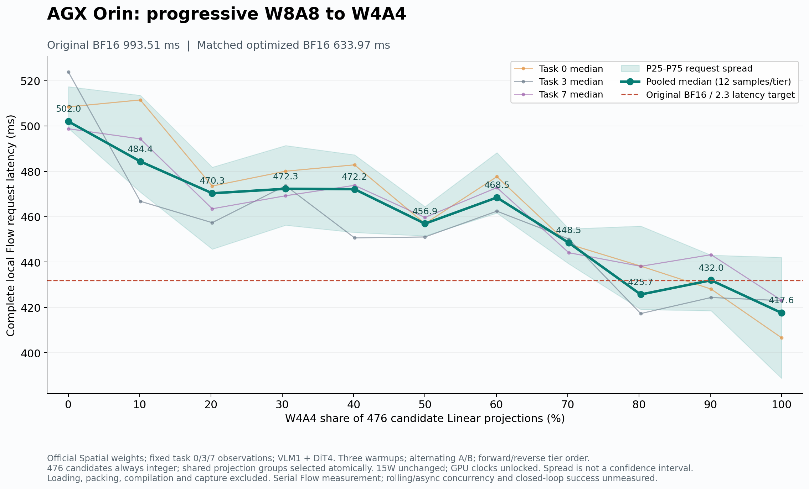
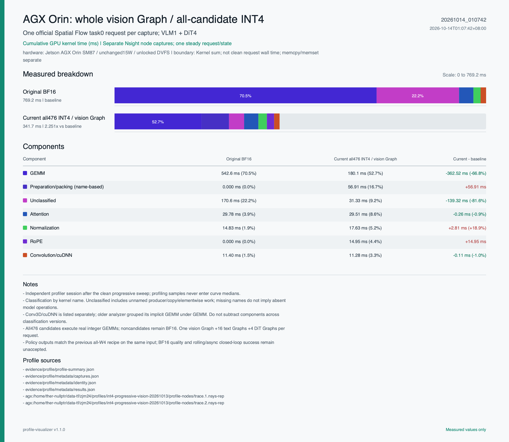

# AGX Orin 渐进量化扫描汇报

本次将候选投影从全部 W8A8，按固定累计顺序逐步切换到全部 W4A4，共测量 11 档。当前扫描窗口：原始 BF16 请求中位数 **993.51 ms**，全 W8A8 **502.01 ms（1.979×）**，全 W4A4 **417.61 ms（2.379×）**。相同辅助优化 BF16 为 **633.97 ms**；量化本身的增量加速分别为 **1.263×、1.518×**。

这些结果来自三个固定真实观测的**串行官方 Spatial Flow 请求：VLM 1 次 + DiT 4 次**，包括预处理、状态归一化和动作解码。不包含网络通信、控制队列或仿真推进；没有评估 rolling DiT + 异步 VLM 并发，也没有闭环成功率结论。

## 文件说明

- [渐进量化延迟曲线](图/渐进量化延迟曲线.png)：本次 11 档扫描；另附 SVG，便于编辑。
- [渐进量化结果.csv](数据/渐进量化结果.csv)：各档延迟、P25/P75、加速比及三个输入的动作误差。
- [实验配置与对照.csv](数据/实验配置与对照.csv)：两个 BF16 对照及 11 档量化的逐项配置和结果。
- [逐层精度映射.csv](数据/逐层精度映射.csv)：476 个候选投影在每一档的实际精度。
- [稳定延迟样本.csv](数据/稳定延迟样本.csv)：288 条无 profiler 稳定测量，含输入 seed、请求/GPU 延迟和实测 GPU 频率。
- [算子耗时对照图](图/算子耗时对照.png)：独立 Nsight 采样的原始 BF16 / 全 W4A4 对照。
- [原始实验配置记录](数据/原始实验配置记录.json)、[输入指纹](数据/输入指纹.json)：保留源码、环境、输入及扫描前检查的原始记录。

## 共用实验配置

| 项目 | 配置 |
|---|---|
| 硬件 | Jetson AGX Orin，SM87，约 64 GB 统一内存 |
| 功耗与时钟 | MODE_15W（id 1）；未修改系统配置，GPU DVFS 未锁定，记录范围 306–408 MHz |
| 源码 HEAD | `11d9ddb6da0087ba9404850033646a43cf8045c2`；实际运行还包含原有工作区修改和个人实验脚本，不能只凭 HEAD 复现 |
| 权重 | `nvidia/GR00T-N1.7-LIBERO` 的 `libero_spatial` |
| 权重 revision | `2ea293aa20ba7cf5bbf3ba17a5fbcb1a01cbfe21` |
| 软件 | Python 3.10；Torch 2.8.0；CUDA 12.6；Triton 3.4.0；Flash Attention 2.8.2；Transformers 4.57.3 |
| 输入 | task 0 / 3 / 7，episode 0；对应 seed 1000 / 4000 / 8000；各配置复用同一观测、初始状态及随机种子 |
| 推理方式 | 官方非流式 Flow，串行 VLM 1 次 + DiT 4 次 |
| 候选集合 | 469 个 nn.Linear + 7 个 category=2 投影，共 476 个 |
| 非候选模块 | 保留 BF16，包括 attention QK/AV；“全 W4A4”指候选投影全部量化 |

原始 BF16 使用原始执行方式；相同辅助优化 BF16 和所有量化档使用同一套辅助执行优化：已有 BF16 融合、原生视觉 RoPE、完整视觉 CUDA Graph、16 个文本 block Graph，以及纯 DiT Graph。视觉 Graph 覆盖 Conv3D、24 个视觉 block、3 个 DeepStack merger 和最终 merger；每个请求共 21 次 Graph replay。

各档固定使用当前打包和 GEMM 执行版本：默认 256 线程打包、既有按形状选择的 tactic（默认 0）。未加入新的线程映射或单行 logits 改动。channels-last-3D、norm/modulation/quant 融合、残差 norm/quant 融合和额外 conditioning 分组均未启用。位置元数据按实际 grid 缓存，输入每次刷新，输出克隆，KV 更新在 Graph 外执行。

W4A4 使用 alpha=0.5 的逐通道激活平衡，只用 task 0 的 BF16 完整请求校准；task 3、7 不参与校准。W8A8 保留未平衡的原有量化配方。未被选为 W4A4 的候选始终保持 W8A8，没有候选投影回退 BF16。

## 扫描与计时方法

层选择顺序固定为 Vision → text → 视觉特征 transformer → DiT blocks → additional projections → category=2；组件内按自然数字顺序排列，共享输入投影组整体切换。按累计前缀取不低于名义十分位的可用分档，因此实际占比略偏离整十数。横轴是候选投影**数量占比**，不代表参数量或 FLOPs 占比。

先正序扫描 0→10，再逆序 10→0。每个输入、每个配置、每个顺序先做 3 次完整预热，再做 2 次稳定测量；3 个输入合计 **12 个样本/档**。原始 BF16 与候选交错测量，共 144 个锚点样本；相同辅助优化 BF16 在扫描前后测量，共 12 个样本。

稳定计时排除加载、编译、安装、权重打包、Graph 捕获、reset/seed、预热和输出检查。墙钟延迟与 CUDA-event elapsed 分开保存；曲线纵轴采用完整本地请求墙钟中位数，阴影 P25–P75 表示样本分布，不能解释为置信区间。Profiler 采样单独进行，没有混入曲线数据。

## 各档结果

| 配置 | W4A4 / W8A8 数量 | W4A4 占比 | 请求中位数 ms | 总体加速 | 量化增量加速 |
|---|---:|---:|---:|---:|---:|
| 原始 BF16 | 候选全部 BF16 | — | 993.51 | 1.000× | 0.638× |
| 相同辅助优化 BF16 | 候选全部 BF16 | — | 633.97 | 1.567× | 1.000× |
| tier00 | 0 / 476 | 0.00% | 502.01 | 1.979× | 1.263× |
| tier01 | 48 / 428 | 10.08% | 484.38 | 2.051× | 1.309× |
| tier02 | 96 / 380 | 20.17% | 470.35 | 2.112× | 1.348× |
| tier03 | 145 / 331 | 30.46% | 472.32 | 2.103× | 1.342× |
| tier04 | 191 / 285 | 40.13% | 472.16 | 2.104× | 1.343× |
| tier05 | 238 / 238 | 50.00% | 456.95 | 2.174× | 1.387× |
| tier06 | 286 / 190 | 60.08% | 468.48 | 2.121× | 1.353× |
| tier07 | 334 / 142 | 70.17% | 448.50 | 2.215× | 1.414× |
| tier08 | 382 / 94 | 80.25% | 425.72 | 2.334× | 1.489× |
| tier09 | 429 / 47 | 90.13% | 431.99 | 2.300× | 1.468× |
| tier10 | 476 / 0 | 100.00% | 417.61 | 2.379× | 1.518× |

总体加速 = 原始 BF16 中位数 / 当前配置中位数；量化增量加速 = 相同辅助优化 BF16 中位数 / 当前配置中位数。两种口径应分别汇报。

最低中位数出现在全 W4A4 档。曲线并非严格单调，例如 50%→60% 和 80%→90% 时延迟有所上升。本次全 W4A4 的两个扫描顺序配对加速中位数分别为 **2.470×、2.341×**。扫描前同版独立 A/B 为 **2.295×**，反向配对约 **2.294×**；当前结果改善来自不同测量窗口，扫描期间没有新增优化。由于 DVFS 未锁定、样本量有限，不能保证所有输入和运行条件均达到 2.3×。

## 算子采样与误差边界

独立采样只测 task 0 的一个完整请求。原始 BF16 / 全 W4A4 的 kernel 累计耗时为 **769.24 / 341.70 ms**；首末 kernel 的 GPU 时间跨度为 **1132.73 / 414.59 ms**；kernel 数为 **5060 / 3334**，全 W4A4 采到 **927 个整数 GEMM、21 次 Graph replay**。图中分类按 kernel 名称判断，未识别项可能包含多种操作；这些采样值不能替代上面的无 profiler 请求延迟。

各档动作误差保存在曲线 CSV 的 `raw_action_relative_l2_task0/3/7` 列。全 W8A8 为 **0.0210 / 0.0146 / 0.0195**，全 W4A4 为 **0.7437 / 0.5724 / 0.4790**。相对 L2 是输出差异，不是准确率或成功率；本次优先测延迟，INT4 的策略质量尚未验收。

0%/100% 两端点与固定精度控制的输出逐位一致，退出后恢复 BF16 的检查通过。这证明接入与恢复一致性，不能证明 INT4 与 BF16 等价。完整原始证据和实验脚本保留在同级历史目录 `20261013_235103_agx_progressive_vision`；本文件夹仅汇总便于阅读的数据和配置，不包含权重、完整 trace 或环境。
